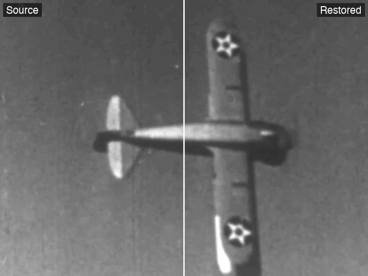
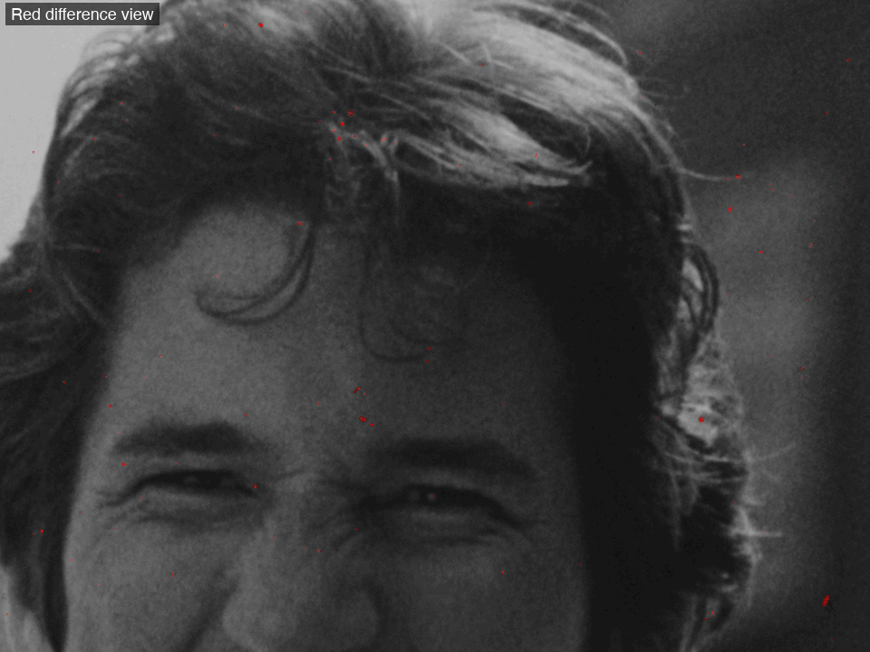
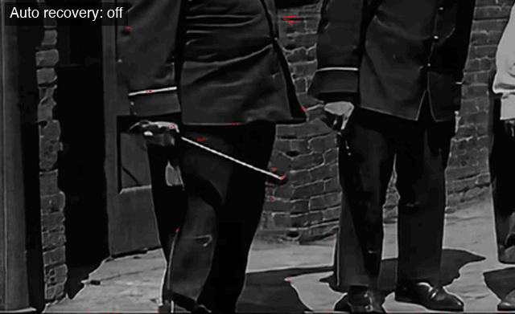
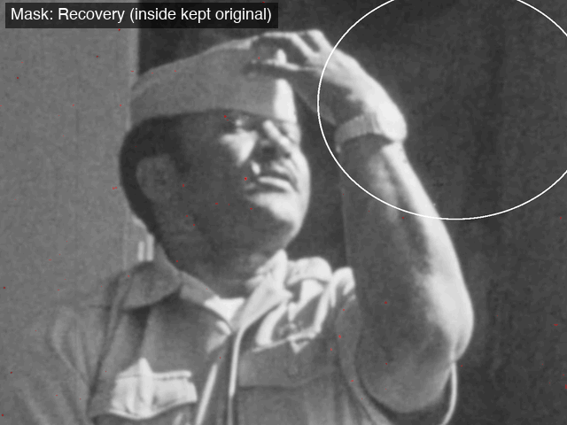
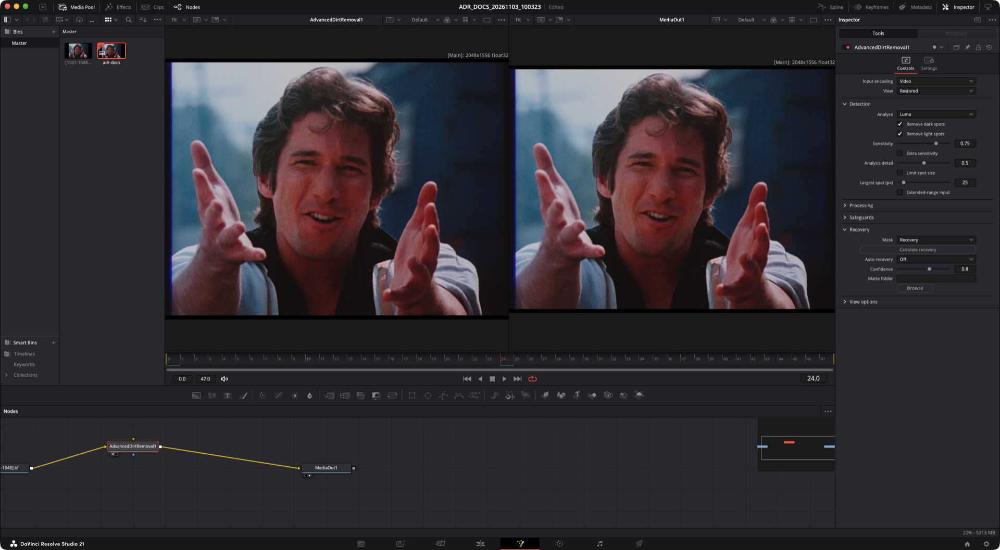

# Advanced Dirt Removal

[](https://github.com/fabiocolor/Advanced-Dirt-Removal/releases)
[](LICENSE)
[](WEIGHTS_LICENSE)
[](#install)

Free, open-source dirt and dust removal for film scans. I made it for archives,
educators and small restoration projects.

Advanced Dirt Removal is an OFX plugin with its own temporal repair engine. It
looks for dirt, dust and sparkle that appear in one frame only, and fills those
spots from the frames before and after, with motion compensation. So it masks
the damage using picture that is really there in the neighbouring frames. It
doesn't invent detail, and it can't fix damage that stays in the same place for
several frames, like a long scratch or a hair in the gate.

It runs on the GPU (Apple Metal, NVIDIA CUDA, and OpenCL for AMD, Intel and
NVIDIA) and falls back to the CPU. You get the same result on all of them, so a
render on one machine matches a render on another.



Source on the left of the line, restored on the right, at the default
settings: the dark specks and short scratches on the title card go, the
lettering and the print's texture stay. The footage is a 35mm trailer scan.
A 26-second colour sequence from another trailer, with the same wipe:
[video](assets/documentation/adr-2.0-before-after.mp4).
1:1 detail: [still](assets/documentation/adr-2.0-detail-before-after.png).
About the footage: [assets/documentation](assets/documentation/README.md).

## What's in it

One effect does everything:

- **Input encoding:** Video, or Cineon log for film scans. Cineon is cleaned in
  linear, and pixels it doesn't touch keep their exact log values.
- **Recovery mask:** paint where you want the original back.
- **Auto recovery:** a small built-in model looks at every repaired spot and
  gives back the ones that look like real picture detail. It works up to a
  point, so check its matte and paint over what it gets wrong.
- **Spanish dirt removal:** repair only where you paint.
- **Views:** Restored, Red difference (every repair in red on a grey picture),
  True difference and the auto-recovery matte.



A close-up from the *Breathless* (1983) trailer in the Red difference view:
every speck it repaired is a red dot. Check this view before you trust a
render ([video](assets/documentation/adr-2.0-red-difference.mp4)).



Fast movement can look like dirt. Here a man swings a stick past a brick wall
(*Neighbors*, 1920). With auto recovery off, the effect repairs pieces of the
moving arm, stick and legs (red). With auto recovery on, it gives most of them
back, and the shot shows the original movement.



The Mask input, with one area painted (the white ellipse), in the Red
difference view. With **Recovery** the painted area keeps the original, so the
scratch inside it stays. With **Spanish dirt removal** only the painted area
is repaired.

> **New in 2.0.** Version 1.x was a Fusion macro around DaVinci Resolve's
> built-in dirt removal. 2.0 is a stand-alone plugin with its own engine, for
> Resolve, Nuke and other OFX hosts on macOS, Windows and Linux. What changed:
> [CHANGELOG.md](CHANGELOG.md). What has been tested: [docs/TESTED.md](docs/TESTED.md).

**2.0.0 is not published yet.** Until it is, the releases page and winget still
give you 1.1.3. Everything below describes 2.0.

## Install

The installers are unsigned. I don't pay for an Apple Developer ID or a Windows
code-signing certificate, so the first time you'll get a warning. This is
how to get past it. Full details, manual installation and uninstalling are in
[docs/INSTALL.md](docs/INSTALL.md).

**macOS.** Download `AdvancedDirtRemoval-<version>-macos.zip` from the
[releases page](https://github.com/fabiocolor/Advanced-Dirt-Removal/releases),
unzip it and open the `.pkg`. macOS will block it the first time:

- macOS 15 and later: System Settings → Privacy & Security → **Open Anyway**.
- macOS 14 and earlier: right-click the `.pkg` → **Open** → **Open**.

Or remove the quarantine flag in Terminal and open it normally:

```sh
xattr -dr com.apple.quarantine ~/Downloads/AdvancedDirtRemoval-<version>.pkg
```

**Windows.** Download `AdvancedDirtRemoval-Setup-<version>.exe` (or the
`-win64.zip` and extract it) and run it. When SmartScreen says "Windows
protected your PC", click **More info** → **Run anyway**. It needs
administrator rights for the shared OFX folder.

winget: a 2.0.0 manifest is drafted in
[`installers/win/winget/2.0.0`](installers/win/winget/2.0.0) and is pending
approval. As it is right now, `winget install FabioColor.AdvancedDirtRemoval`
still installs 1.1.3.

**Linux.**

```sh
tar -xzf AdvancedDirtRemoval-<version>-linux-x86_64.tar.gz
cd AdvancedDirtRemoval-<version>-linux-x86_64
sudo ./install.sh
```

Restart your host afterwards. The plugin goes in the standard OFX folder:
`/Library/OFX/Plugins` (macOS), `C:\Program Files\Common Files\OFX\Plugins`
(Windows) or `/usr/OFX/Plugins` (Linux).

## Quick start

1. Add **Advanced Dirt Removal** (group **FabioColor**) to the complete,
   unedited shot:
   - **DaVinci Resolve:** Fusion page → Add Tool → OpenFX → FabioColor.
   - **Nuke:** Tab → "Advanced Dirt Removal".
2. Set **Input encoding** to *Cineon log* for Cineon scans. Leave *Video*
   otherwise.
3. Check what it did with **View: Red difference**.
4. Where it repaired real detail, press **Calculate recovery** for auto
   recovery, and/or connect a paint or mask tool to the **Mask** input and paint
   the original back.

The [user guide](docs/USER_GUIDE.md) goes through every control, the recovery
workflow and the views.



The plugin in DaVinci Resolve Studio 21.1 on macOS, Fusion page, with an
earlier public-domain test clip: the effect's output on the left, its controls
on the right.
[Red difference in Resolve](assets/documentation/macos-resolve-2.0-red-difference.png).
The screenshots are from macOS. Resolve and the plugin's controls look the
same on Windows and Linux.

| Control group | Controls |
| --- | --- |
| Top | Input encoding, View |
| Detection | Analyse, Remove dark spots, Remove light spots, Sensitivity, Extra sensitivity, Analysis detail, Limit spot size, Largest spot, Extended-range input |
| Processing | Repair amount, Blend repairs, Blend amount |
| Safeguards | Motion guard, Shot changes, Shot-change guard, Flash guard |
| Recovery | Mask (Recovery / Spanish dirt removal), Calculate recovery, Auto recovery, Confidence, Matte folder |
| View options | Difference threshold, Red difference intensity, Red highlight opacity, Grayscale background, Difference gain |

## Limits

- Very fast motion can look like dirt. Raise **Motion guard**, use auto
  recovery and paint back what is left. Always review moving shots.
- Damage that stays for more than a frame or two isn't touched.
- Interlaced material isn't supported. Deinterlace first.
- Tested hosts are DaVinci Resolve Studio 21 (Fusion page) and Nuke 17 on
  macOS, Windows and Linux. The Resolve Color and Edit pages, other OFX hosts
  and Intel Macs haven't been tested yet. Premiere Pro and After Effects don't
  load OFX plugins, so they aren't supported yet.

The plugin keeps a diagnostic log (backend, device, timing, errors). Its
location is in the [user guide](docs/USER_GUIDE.md#diagnostics-speed-and-limits).
Please attach it when you report a problem.

## Build from source

```sh
cmake -S . -B build -DCMAKE_BUILD_TYPE=Release -DADR_WITH_OPENCL=ON
cmake --build build --config Release --parallel
python3 tools/check_release.py build
```

Options for CUDA, OpenCL and the CPU fallback are in [docs/BUILD.md](docs/BUILD.md).
There is no CI service. Releases are built and checked locally.

## Support

- Issues: [GitHub Issues](https://github.com/fabiocolor/Advanced-Dirt-Removal/issues)
- Discussions: [GitHub Discussions](https://github.com/fabiocolor/Advanced-Dirt-Removal/discussions)

Results from hosts, systems and GPUs I haven't tested are very welcome.

## Licence

The code and the model weights have different licences.

- **Source code:** MIT. See [LICENSE](LICENSE).
- **Auto-recovery model weights** (`ofx/resources/recovery-model.bin`, also
  installed inside the plugin): CC BY-NC 4.0, for non-commercial use only. See
  [WEIGHTS_LICENSE](WEIGHTS_LICENSE). The weights are versioned per release and
  each release also attaches them as a separate file.
- **OpenFX headers** in `ofx/vendor/openfx`: BSD 3-Clause, see
  [ofx/vendor/openfx/LICENSE.md](ofx/vendor/openfx/LICENSE.md).

Commercial licensing available — contact Fabio.
You can reach me through [GitHub](https://github.com/fabiocolor) or the
[Discussions](https://github.com/fabiocolor/Advanced-Dirt-Removal/discussions) page.

<div align="center">
  <sub>Film restoration tools for archives, educators and preservation projects</sub>
</div>
