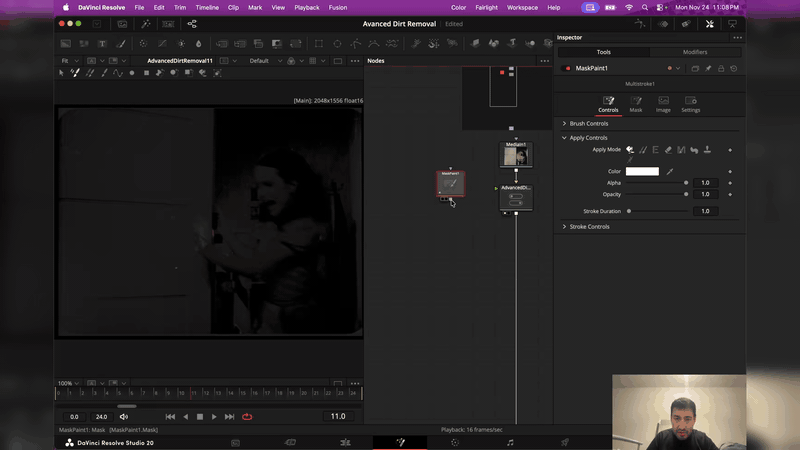

# Advanced Dirt Removal

[](https://github.com/fabiocolor/Advanced-Dirt-Removal/releases)
[](LICENSE)
[](#install)
[](https://github.com/fabiocolor/Advanced-Dirt-Removal/releases/latest)

Free, open-source dirt and dust removal for film scans, made for archives,
educators and restoration projects.

Advanced Dirt Removal has two parts:

- **The Advanced Dirt Removal effect** (new in 2.0): an OFX plugin with its own
  temporal repair engine. It finds dirt, dust and sparkle that appear in one
  frame only and repairs them from the neighbouring frames, with motion
  compensation. It runs on the GPU (Apple Metal, NVIDIA CUDA, OpenCL for AMD,
  Intel and NVIDIA) and falls back to the CPU. It works in DaVinci Resolve, Nuke
  and other OFX hosts on macOS, Windows and Linux.
- **The Fusion macro** for DaVinci Resolve: a recovery workflow around the
  effect, for video and Cineon scans, with a recovery brush, Spanish dirt
  removal, a red difference view and other comparison views.

> **New in 2.0:** the macro now uses the Advanced Dirt Removal effect instead of
> Resolve's built-in Automatic Dirt Removal, and the effect also works on its own
> in any OFX host. See [docs/TESTED.md](docs/TESTED.md) for exactly which hosts,
> systems and GPUs have been tested.

## Video tutorial (1.x macros)

[](https://youtu.be/Gepw0XG0FGw?si=i8R3JqCKS8fHNTm3)

**[▶️ Watch the complete tutorial on YouTube](https://youtu.be/Gepw0XG0FGw?si=i8R3JqCKS8fHNTm3)**

## Install

**Windows:**

```powershell
winget install FabioColor.AdvancedDirtRemoval
```

Update later with `winget upgrade FabioColor.AdvancedDirtRemoval`, or download
the installer from the [latest release](https://github.com/fabiocolor/Advanced-Dirt-Removal/releases/latest).

**macOS:** download `AdvancedDirtRemoval-<version>.pkg` from the latest release
and open it.

**Linux:** download `AdvancedDirtRemoval-<version>-linux-x86_64.tar.gz`, extract
it and run `sudo ./install.sh`.

The installers put the effect in the standard OFX plugin folder and the macro in
Resolve's Fusion Macros folder. Restart your host afterwards. Manual installation,
folder locations and uninstalling: [docs/INSTALL.md](docs/INSTALL.md).

## The Advanced Dirt Removal effect

Add **Advanced Dirt Removal** (group **FabioColor**) to a clip:

- **DaVinci Resolve:** Color page → OpenFX library, or Fusion page → Add Tool →
  OpenFX. Render a Fusion composition, or the timeline, as usual.
- **Nuke:** Tab → "Advanced Dirt Removal".
- **Other OFX hosts:** look for the FabioColor group in the host's OFX effects.

The effect needs whole frames and uses the two frames before and the two after
the current one, so give it the complete, unedited shot or clip. It works on the
RGB values exactly as the host delivers them (float, half or 16-bit) and copies
alpha through. Review moving shots before delivery: very fast motion can look like
dirt.

| Control | Default | What it does |
| --- | --- | --- |
| Enabled | on | Off passes the source through unchanged. |
| **Detection** | | |
| Analyse | Luma | Luma finds spots in brightness; RGB also finds spots that differ only in colour. |
| Remove dark spots | on | Repair spots darker than their surroundings (dust on a print, emulsion specks). |
| Remove light spots | on | Repair spots brighter than their surroundings (dirt on a negative, scratches through to the base). |
| Sensitivity | 0.75 | How readily a temporary change is treated as dirt. Higher finds fainter spots and risks repairing real detail. |
| Extra sensitivity | off | For heavily damaged material. Can remove real detail. |
| Analysis detail | 0.5 | Balance of fine against coarse analysis when separating dirt from grain and noise. |
| Limit spot size | off | Ignore spots larger than Largest spot. |
| Largest spot (px) | 25 | Largest spot diameter repaired when Limit spot size is on. |
| Extended-range input | off | Analyse values below 0 or above 1 (scene-referred or log-to-linear material) instead of the normal display range. |
| **Processing** | | |
| Repair amount | 1.0 | How strongly detected spots are replaced from neighbouring frames (0 to 2). |
| Blend repairs | on | Soften the edges of repairs so they blend with grain. |
| Blend amount | 0.5 | How much repair edges are softened. |
| **Safeguards** | | |
| Motion guard | 0.25 | Protect moving detail. Higher protects more and cleans less in motion. |
| Shot changes | Guard | Frames from another shot are never used. Off: no extra care. Guard: repair next to a shot change more cautiously. Skip: leave those frames unrepaired. |
| Shot-change guard | 0.75 | How cautious Guard is next to a shot change. |
| Flash guard | off | Leave frames detected as single-frame flashes unrepaired. |

The controls are grouped as Detection, Processing and Safeguards. Start with the
defaults. If real detail is being removed, lower **Sensitivity** or raise
**Motion guard**; if dirt remains, raise **Sensitivity** or try
**Analyse: RGB**.

Every GPU and the CPU give byte-identical results, so a render on one machine
matches a render on any other. The plugin keeps a diagnostic log (backend,
device, timing, errors) in `~/Library/Logs/FabioColor/AdvancedDirtRemoval`
(macOS), `%LOCALAPPDATA%\FabioColor\AdvancedDirtRemoval\Logs` (Windows) or
`~/.local/state/fabiocolor/advanced-dirt-removal/logs` (Linux). Please attach it to
issue reports.

## The Fusion macro (DaVinci Resolve)


*Recovery brush: paint back original detail where an automatic repair went wrong*

One macro, **Advanced Dirt Removal**, for video and Cineon film scans. In the
Fusion page press `Shift+Space`, type "Advanced Dirt Removal" and connect
`MediaIn → Advanced Dirt Removal → MediaOut`.

- **Input encoding:** *Video / already converted*, or *Cineon log* if the values
  entering the macro are still Cineon encoded. In Cineon mode the effect works
  on linear values (with Extended-range input on) and only its repair is added
  back to the log input, so areas it leaves alone keep their exact original
  values. Output keeps the input encoding.
- **Recovery brush:** connect a Mask Paint (or Magic Mask) tool directly to the
  macro's second input and paint where the original should be kept. **Recovery
  mode** (Advanced): *Mask Paint recovery* (paint keeps the original, the
  default), *Apply repair inside mask* (Spanish dirt removal: only painted areas
  are repaired) or *Ignore mask*.
- **Moving detail:** raise **Motion guard** where fast motion is mistaken for
  dirt, and paint back anything that is still lost.
- **View Mode:** Restored, Original, Compare wipe, True difference, **Red
  difference**, Repair eligibility and Changed pixels.
- **Red difference:** a grey picture with every repaired pixel in red.
  **Difference threshold (%)** hides changes smaller than the threshold (default
  0.1%, so only real repairs show) and **Red difference intensity** sets the
  highlight brightness. Both affect the view only.
- **Limits (Advanced):** repair only inside a rectangle, or only between two
  frames.
- The effect's controls (Sensitivity, Motion guard and the rest) are on the
  macro: everyday ones on the first page, the rest under Advanced.

Version 1.x had two macros (Linear and Cineon) and an optical-flow motion mask;
2.0 replaces both macros, and the effect's own Motion guard replaces the motion
mask. The installers remove the old Cineon macro. Compositions saved with 1.x keep working
as they were. Details: [docs/TECH_SPEC.md](docs/TECH_SPEC.md).

## Build from source

```sh
cmake -S . -B build -DCMAKE_BUILD_TYPE=Release -DADR_WITH_OPENCL=ON
cmake --build build --config Release --parallel
python3 tools/check_release.py build
```

Options for CUDA, OpenCL and the CPU fallback, and the local checks:
[docs/BUILD.md](docs/BUILD.md). There is no CI service; releases are built and
checked locally.

## Support

- Issues: [GitHub Issues](https://github.com/fabiocolor/Advanced-Dirt-Removal/issues)
- Discussions: [GitHub Discussions](https://github.com/fabiocolor/Advanced-Dirt-Removal/discussions)

## License

MIT; see [LICENSE](LICENSE). The OpenFX headers in `ofx/vendor/openfx` are under
their own BSD 3-Clause licence ([ofx/vendor/openfx/LICENSE.md](ofx/vendor/openfx/LICENSE.md)).

<div align="center">
  <sub>Making film restoration accessible to archives, educators and preservation enthusiasts</sub>
</div>
