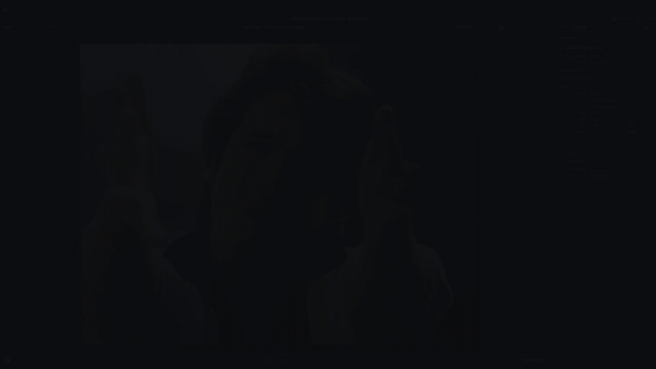
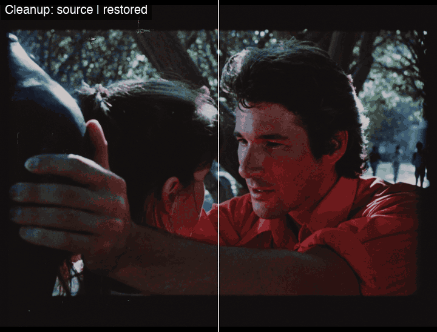
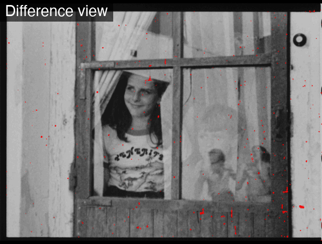
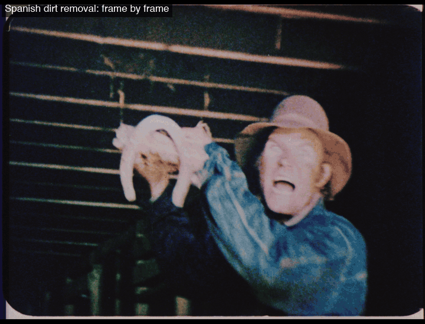
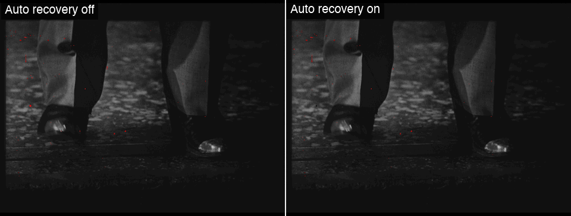
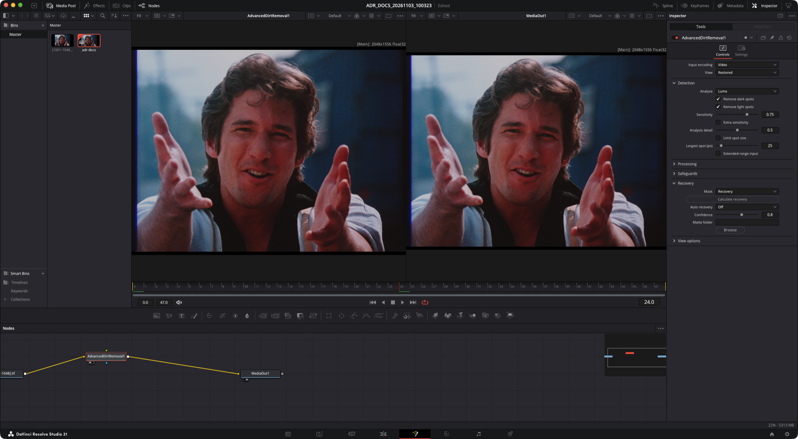

# Advanced Dirt Removal

[](https://github.com/fabiocolor/Advanced-Dirt-Removal/releases)
[](LICENSE)
[](WEIGHTS_LICENSE)
[](#install)

Free, open-source OFX plugin that removes dust and dirt from film scans, for
DaVinci Resolve, Nuke and other OFX hosts. Built for archives, educators and
small restoration projects.



[Full-quality MP4 (1080p60, 48 s)](assets/documentation/demo-2.1.mp4)

It looks for dirt, dust and sparkle that appear in a single frame and fills
those spots from the neighbouring frames with motion compensation. It masks
damage using real picture from adjacent frames rather than inventing detail, so
damage that stays in place across several frames (like a long scratch or a hair
in the gate) is left alone.

Runs on the GPU (Apple Metal, NVIDIA CUDA, and OpenCL for AMD, Intel and
NVIDIA) with a CPU fallback. Every backend produces the same result, so renders
match across machines.

## What's in it

One effect does everything:

- **Input encoding:** Video, or Cineon log for film scans. Cineon is cleaned in
  linear, and pixels it doesn't touch keep their exact log values.
- **Paint in the viewer (Resolve):** paint where you want the original back,
  or where you want dust removed, directly in the effect's viewer. Other hosts
  use the Mask input.
- **Auto recovery:** a small built-in model looks at every repaired spot and
  gives back the ones that look like real picture detail. You can paint on top
  of its matte to add or remove areas.
- **Spanish dirt removal:** manual frame-by-frame dust cleaning. Paint over a
  speck and only that spot is repaired.
- **Additional source:** paint a clip that was cleaned elsewhere back to its
  original.
- **Views:** Restored, Red difference (every repair in red on a grey picture),
  True difference and the auto-recovery matte.

## What it does

Clips from 35mm trailer scans at 2K. Each links to the full-quality MP4.

**Cleanup.** The dust and specks go; the picture and its grain stay.



[Full-quality video](https://github.com/user-attachments/assets/f63015f2-2e2f-429e-8a57-5d5ce77a3ae5)

**Difference view.** Every repair in red.



[MP4, 7 s](assets/documentation/difference.mp4)

**Spanish dirt removal.** Manual frame-by-frame dust cleaning, only where you
mask.



[MP4, 10 s](assets/documentation/spanish-dirt-removal.mp4)

**Auto recovery.** Off and on. Moving highlights are given back; the dirt stays
repaired.



[MP4, 10.5 s](assets/documentation/auto-recovery.mp4)

Sources: [SOURCES.md](assets/documentation/SOURCES.md).

> **New in 2.1.** Paint the original back or clean individual spots directly
> in the viewer on the DaVinci Resolve Color and Edit pages. Use **Additional
> source** to paint detail back into an already cleaned clip.
> [Changelog](CHANGELOG.md) · [What was tested](docs/TESTED.md)

## Install

The installers are unsigned. I don't pay for an Apple Developer ID or a Windows
code-signing certificate, so the first time you'll get a warning. This is
how to get past it. Full details, manual installation and uninstalling are in
[docs/INSTALL.md](docs/INSTALL.md).

**macOS.** Download `AdvancedDirtRemoval-<version>-macos.zip` from the
[releases page](https://github.com/fabiocolor/Advanced-Dirt-Removal/releases),
unzip it and open the `.pkg`. macOS will block it the first time:

- macOS 15 and later: System Settings → Privacy & Security → **Open Anyway**.
- macOS 14 and earlier: right-click the `.pkg` → **Open** → **Open**.

Or remove the quarantine flag in Terminal and open it normally:

```sh
xattr -dr com.apple.quarantine ~/Downloads/AdvancedDirtRemoval-<version>.pkg
```

**Windows.** Download `AdvancedDirtRemoval-Setup-<version>.exe` (or the
`-win64.zip` and extract it) and run it. When SmartScreen says "Windows
protected your PC", click **More info** → **Run anyway**. It needs
administrator rights for the shared OFX folder.

Or with winget: `winget install FabioColor.AdvancedDirtRemoval`.

**Linux.**

```sh
tar -xzf AdvancedDirtRemoval-<version>-linux-x86_64.tar.gz
cd AdvancedDirtRemoval-<version>-linux-x86_64
sudo ./install.sh
```

Restart your host afterwards. The plugin goes in the standard OFX folder:
`/Library/OFX/Plugins` (macOS), `C:\Program Files\Common Files\OFX\Plugins`
(Windows) or `/usr/OFX/Plugins` (Linux).

## Quick start

1. Add **Advanced Dirt Removal** (group **FabioColor**) to the complete,
   unedited shot:
   - **DaVinci Resolve:** Fusion page → Add Tool → OpenFX → FabioColor, or
     drag it from the OpenFX library on the Color or Edit page.
   - **Nuke:** Tab → "Advanced Dirt Removal".
2. Set **Input encoding** to *Cineon log* for Cineon scans. Leave *Video*
   otherwise.
3. Check what it did with **View: Red difference**.
4. Where it repaired real detail, press **Calculate recovery** for auto
   recovery, and/or paint the original back. In Resolve, turn on the viewer's
   Open FX Overlay and paint in the viewer; in other hosts, connect a paint or
   mask tool to the **Mask** input.

The [user guide](docs/USER_GUIDE.md) goes through every control, the recovery
workflow and the views.



DaVinci Resolve Studio 21.1 on macOS (Fusion page), showing the restored output
on the left and the plugin controls on the right
([Red difference view](assets/documentation/macos-resolve-2.0-red-difference.png)).

| Control group | Controls |
| --- | --- |
| Top | Input encoding, View |
| Detection | Analyse, Remove dark spots, Remove light spots, Sensitivity, Extra sensitivity, Analysis detail, Limit spot size, Largest spot, Extended-range input |
| Processing | Repair amount, Blend repairs, Blend amount |
| Safeguards | Motion guard, Shot changes, Shot-change guard, Flash guard |
| Paint (Resolve) | Method (Recovery / Spanish dirt removal), Paint in viewer, Show strokes, Tool, Brush, Size, Softness, Undo paint, Redo paint, Strokes, Brush options, Source setup |
| Recovery | Method (Mode in other hosts), Calculate recovery, Auto recovery, Confidence, Matte folder |
| Cleaning defaults (Resolve) | Save as my default, Load my default, Use factory settings |
| View options | Difference threshold, Red difference intensity, Red highlight opacity, Grayscale background, Difference gain |

## Limits

- Very fast motion can look like dirt. Raise **Motion guard**, use auto
  recovery and paint back what is left. Always review moving shots.
- Damage that stays for more than a frame or two isn't touched.
- Interlaced material isn't supported. Deinterlace first.
- Tested on DaVinci Resolve Studio 21 and Nuke 17 across macOS, Windows, and
  Linux. Other OFX hosts and Intel Macs are untested; Premiere Pro and After
  Effects aren't supported since they don't load OFX plugins.

The plugin keeps a diagnostic log (backend, device, timing, errors). Its
location is in the [user guide](docs/USER_GUIDE.md#diagnostics-speed-and-limits).
Please attach it when you report a problem.

## Build from source

```sh
cmake -S . -B build -DCMAKE_BUILD_TYPE=Release -DADR_WITH_OPENCL=ON
cmake --build build --config Release --parallel
python3 tools/check_release.py build
```

Options for CUDA, OpenCL and the CPU fallback are in [docs/BUILD.md](docs/BUILD.md).
There is no CI service. Releases are built and checked locally.

## Support

ADR is free and open source, and I make it in my own time. If it saves you work, you can support it on [Ko-fi](https://ko-fi.com/fabiocolor). Contributions, bug reports and test footage are welcome too.

- Issues: [GitHub Issues](https://github.com/fabiocolor/Advanced-Dirt-Removal/issues)
- Discussions: [GitHub Discussions](https://github.com/fabiocolor/Advanced-Dirt-Removal/discussions)

Results from hosts, systems and GPUs I haven't tested are very welcome.

## Licence

The code and the model weights have different licences.

- **Source code:** MIT. See [LICENSE](LICENSE).
- **Auto-recovery model weights** (`ofx/resources/recovery-model.bin`, also
  installed inside the plugin): CC BY-NC 4.0, for non-commercial use only. See
  [WEIGHTS_LICENSE](WEIGHTS_LICENSE). The weights are versioned per release and
  each release also attaches them as a separate file.
- **OpenFX headers** in `ofx/vendor/openfx`: BSD 3-Clause, see
  [ofx/vendor/openfx/LICENSE.md](ofx/vendor/openfx/LICENSE.md).

For commercial use of the weights, contact me through
[github.com/fabiocolor](https://github.com/fabiocolor).
You can reach me through [GitHub](https://github.com/fabiocolor) or the
[Discussions](https://github.com/fabiocolor/Advanced-Dirt-Removal/discussions) page.

<div align="center">
  <sub>Film restoration tools for archives, educators and preservation projects</sub>
</div>
